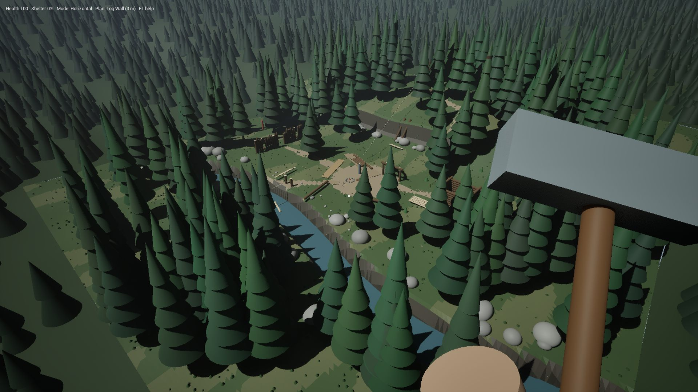
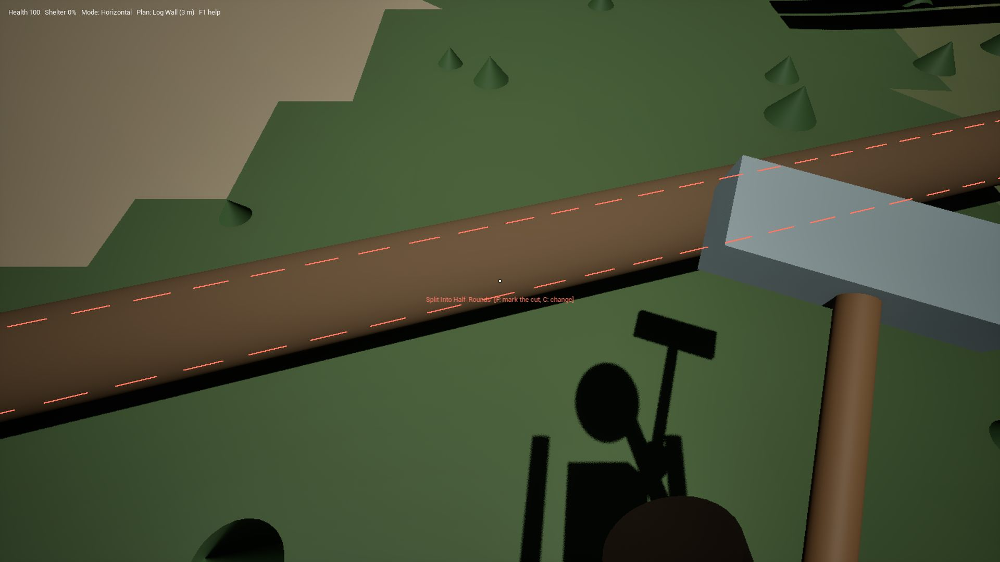
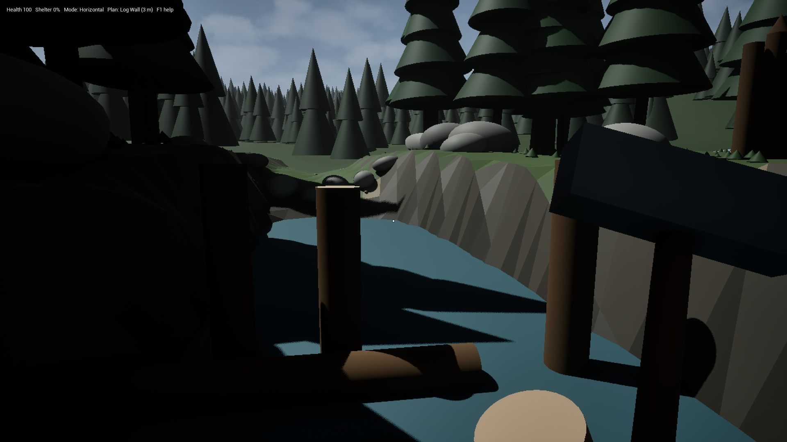
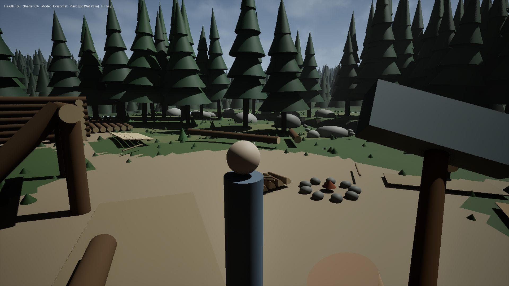

# Rapor: Sons of the Forest kütük sistemi ve VerticalSlice_C

Dal: `sotf-wood-core-integration` · Tarih: 27.10.2026

## Özet

MyProject3'e Sons of the Forest'ın (SOTF) kütük sistemi tek bir oynanış döngüsü olarak kuruldu: ağacı kes, gövdeyi kütüklere ayır, taşı, baktığın yerden kes, yerleştir, destekle, depola. Hepsi `VerticalSlice_C` adlı tek parça bir orman açıklığında denenebiliyor.

- Ekibin paylaştığı üç SOTF belgesindeki mekanik aileleri kodda karşılandı:
  - "Kütükle yapılabilen her şey",
  - "Kütük fiziği ve kesik çizgi sistemi",
  - adım adım anlatılan yapı belgesi.
- Derleme temiz. 48 otomatik testin hepsi geçiyor.
- **Elle oynanarak denenmedi.** Doğrulama otomatik testler ve oyundan alınan ekran görüntüleriyle yapıldı.
- **Bu çalışmanın büyük kısmı commit edilmedi:** 31 dosyada yaklaşık 3.150 satır değişiklik ve 16 yeni dosya var. GitHub'a gönderilmesi bekleniyor.
- Adım adım yapı belgesi 8.7. maddede kesildi. 8.7'den sonraki bölümler bu raporun kapsamında değil.

Sahnenin bölge bölge anlatımı ve ekran görüntüleri için: [VERTICAL_SLICE_C.md](VERTICAL_SLICE_C.md).



## 1. Ağaçtan kütüğe: hasat, taşıma, fizik

| Mekanik | Nasıl çalışıyor |
|---|---|
| Ağaç kesme | Sol tıkla balta sallanır. Ağaç devrilir, yerde durulduktan sonra kütüklere ayrılır. |
| Gövde boyuna göre kütük | Önce sığdığı kadar 600 cm kütük çıkar, kalan boydan bir tane 450, 300 ya da 150 cm parça. Kütükler gövdenin yattığı yere uç uca dizilir. Örnekler: 8 m'lik ağaç 600 verir, 13 m'lik 600 + 450, 16 m'lik 600 + 600 + 150. Eskiden her ağaç, boyundan bağımsız olarak 2 ya da 3 tane 600'lük kütük veriyordu. |
| Taşıma, bırakma | E alır, G bırakır. Bırakılan kütük fizikle düşer, yuvarlanır, diğer kütüklere çarpar. |
| İki kütük | Bir kütük taşırken başka bir kütüğe E'ye basınca ikincisi omza biner. İlki konunca ya da bırakılınca ikincisi ele geçer. Üçüncü kütük alınmaz. |
| Fırlatma | Q. Hızlı bir çarpma tavşanı avlar, çalıyı ezer, düşmanı sendeletip yaralar, yapıya hasar verir. |
| Karaktere değen kütük | Kütükler karakteri fırlatmıyor. Üstünden geçerken garip hareket olmuyor. |

## 2. İşaretler: kırmızı kesim, beyaz yerleştirme

| İşaret | Ne zaman çıkar |
|---|---|
| Kırmızı kesik çizgi | Kütüğün kesileceği yer. Yarmada kütük boyunca, boy kesiminde kütüğün çevresinde halka olarak. |
| Kırmızı kesik koni | Dikili bir kütüğün tepesine bakınca: sivriltme yeri. |
| Gri kesik çizgi | Seçili kesim bu parçada yapılamaz. Yazı nedenini söyler. |
| Beyaz kesik çizgi, kütüğün çevresinde | Taşınan kütüğün bırakılınca duracağı yer. |
| Zeminde beyaz dikdörtgen ve daire | Yatay kütüğün yatacağı alan ve dikey kütüğün tabanı. |
| İki direk arasında beyaz kesik çizgi | Taşınan direk, dikili bir direğe 150, 300, 450 ya da 600 cm'ye yakın gelince tam o aralığa oturur. "300'lük kütük sığar" gibi bir yazı çıkar. |
| Beyaz ok | Kütüğün bağlanacağı nokta: uç bağlantısı, üst üste dizme ya da payanda. |



## 3. Kesim ve şekillendirme

- **Baltayla kesim:**
  - Kütüğe sol tıklayınca kesim yeri işaretlenir ve çizgi kalınlaşıp sabitlenir.
  - Sonraki sol tıklar baltayı sallayıp keser. F de aynı işi yapar.
  - C ya da başka bir kütüğe tıklamak işareti iptal eder.
- **Bakılan yere göre boy kesimi:**
  - Tam kütüğün ortasında halka ortaya gelir ve kesim 300 + 300 verir.
  - Bir ucundan dörtte bir içeride kesim 450 + 150 verir, kısa parça bakılan uçtan çıkar.
  - Yarım kütük ikiye, çeyrek kütük ikiye bölünür.
  - Bu noktaların dışında kesim bakılan yerden yapılır, 25 cm adımla. Yazı iki parçanın boyunu gösterir.
- **Gerçek 3/4 boy:** 450 cm'lik 9 model, 600'lük modellerden 0,75 boyda üretildi: [CreateLog450Meshes.py](../../UnrealEditorScripts/CreateLog450Meshes.py).
- **Yarma ve yontma:** yarım, çeyrek, tek ve çift yüz yontma, kalas, kiriş, oluk, tekne. Her kesim her boyda yapılabiliyor.
- **Kendiliğinden yarma:** tam kütük döşemeye, rampaya, merdivene ya da kapıya götürülünce, yerleşimin uygun olduğu anlaşıldığı anda yarılır. Yarısı yerine konur, öbür yarısı omza geçer.
- **Dikili direği kısaltmak:** yalnızca üstünde hiçbir şey durmayan direk kesilir. Bir şey taşıyan direkte kesim reddedilir.
- **Sivriltme:** dikili kütüğün tepesine baltayla vurulur. Uç parçanın kesitine göre şekillenir: yuvarlakta yuvarlak, çeyrekte kama, kalasta yassı. Sivri uca tırmanmaya çalışan yaralanır ve geri itilir. X tuşu da çalışır.
- **Yarılmış parçalar:** yarım, çeyrek, kalas, oluk ve tekne dikey direk olarak dikilemez.

## 4. Yerleştirme, destek ve kiriş

| Mekanik | Nasıl çalışıyor |
|---|---|
| Modlar | Sağ tıkla değişir: yatay, dikey, 45° çapraz, döşeme, merdiven. Yokuşta yatay kütük eğime uyar. |
| Izgaraya dizme | Yerleştirilmiş bir kütüğe nişan alınca yeni kütük 75 cm'lik ızgaraya oturur. Paralel tutulursa boylamasına biner, R ile çaprazlama oturur, dikey modda direk dikilir. Üst üste binen kütükler birbirinin içine geçer. |
| 6 sıra sınırı | Bir kütük duvarı en fazla 6 sıra olur. |
| Uç bağlantısı | Kütük ucu öbür kütüğün içine gömülür, kesit yüzeyi görünmez. |
| Bir ucu bağlı kütük | Boştaki ucu menteşe gibi aşağı iner, uyarı yazısı çıkmaz. Taşınan bir kütük ya da başka bir parça altına gelince uç kalkar. |
| Kiriş ucunu kaldırma | Boştaki kiriş ucunun altına daha uzun bir direk dikilince uç direğin üstüne kalkar. Eğik kirişlerde de çalışır. |
| Direği kirişe göre kesme | Kirişin ucu zaten bir yere oturuyorsa, ya da direk kirişin ortasının altına dikildiyse, direk kirişin alt yüzüne değecek boya kesilir ve destek olur. |
| Payanda | Çapraz modda üstünde kiriş olan bir direğe bakınca payanda yeri çıkar: direkte 90 cm aşağıdan kirişte 90 cm içeriye. Tam kütük önce yarılır ve boyuna kesilir. Kiriş artık payandaya da dayanır. |
| Orta direği sökme | Delete. Kiriş 4 m'den uzun desteksiz kalacaksa ya da ucu 2,2 m'den fazla boşta kalacaksa sökme reddedilir. Payandalar bu açıklığı kısalttığı için orta direk sökülebilir hale gelir. |
| Ağaca dayanma | Ağaca dayanan kütük gövdeyi destek olarak kullanır. Ağaç kesilirse kütük düşer. |
| Hasar | Ağır hasarlı parçaya yeni parça eklenmez. Parça baltayla sol tıklanarak onarılır, her vuruş 25 hasar puanı siler. |

## 5. Yapı türleri

- **Duvar, çerçeve, köşe:** ızgaraya dizme ve uç bağlantısıyla.
- **Döşeme, tavan, çatı, köprü güvertesi:** Döşeme modunda kütük iki paralel desteğin arasına oturur. Fazla boyu kesilip yere düşer.
- **Rampa ve merdiven:** Merdiven modunda basamaklar 40 cm arayla dizilir, Döşeme modunda bitişik dizilip rampa olur.
- **Tek basamak:** ikinci destek yokken döşeme kenarına bakınca kalas önüne, biraz aşağıya konur.
- **Tek taraflı tepe dolgusu:** kütük taşırken eğik bir kirişe bakıp U'ya basılır. Kirişin altı sıra sıra dolar, her sıra eğime göre kesilir.
- **Kapı, pencere, geçit:**
  - K kapı açar: duvar kütükleri açıklığın iki yanından kesilir, ortadaki parça düşer, üst sıra lento olarak kalır. P pencere açar. Kazık duvarda K geçit açar.
  - Kapı 3 yarılmış kalasla yapılır. Menteşe tarafı ilk kalasın konduğu yandır, kapı dışa açılır.
  - Kilit: çubuk taşıyıp kapalı kapıya içeriden E'ye basılır, çubuk kapının iç yüzüne oturur. L çubuğu çıkarır.
- **Barınak değeri:** üstteki çatı ve çevredeki duvarlar ölçülür ve hayatta kalma sistemine gider. Gece kar yağar ve hava soğur.

## 6. Hazır planlar (19)

Z ile plan seçilir, Y ile yere konur. Plan hayalet kütüklerden oluşur. Her hayalete kütük taşınır ve kütük o parçanın boyuna kesilir.

| Gruplar | Planlar |
|---|---|
| Yapılar | Kütük duvar, sundurma, gözcü kulesi, av barınağı, küçük kütük kabin (35 parça), küçük platform, köşe rampası |
| Ağaçta | Ağaç platformu, ağaç barınağı. Gövdeye ortalanır, alt kirişler gövdeye dayanır ve ağaç kesilirse düşer. |
| Savunma | Kazık savunma duvarı. Çizilerek kurulur: hattın başında Y, sonunda Y. Her 40 cm'ye bir kazık konur. |
| Lojistik | Küçük ve büyük kütük deposu, kızak. Bitince gerçek depo ya da kızak olur. |
| Eşya | Bank, sandalye, kanepe, raf, silah rafı, tavşan kulübesi. Kulübe bitince içine bir tavşan yerleşir. |

## 7. Lojistik

- **Depolar:**
  - Küçük depo 8, büyük depo 24, yakacak odun deposu 32 parça alır. Yakacak odun deposu yalnızca 1/4 boy ve daha küçük parçaları kabul eder.
  - Yakına bırakılan kütük kendiliğinden depoya girer.
- **Kızak:**
  - T ile çekilir. Temel kızak 8 kütük, gelişmiş kızak 16 parça alır.
  - Üstüne atılan ya da bırakılan kütüğü kendiliğinden yükler.
  - Suda batmaz. Derede bırakılırsa akıntıyla sürüklenir.
- **Halat köprü ve zipline:**
  - H ile iki nokta arasına halat bağlanır, eğimli halat zipline olur.
  - Zipline'a verilen kütük aşağı kayar, depoya yakın düşerse depoya girer.
- **Dere:**
  - Akıntı doğuya akar. Serbest kütükler yarıya kadar batmış halde yüzer ve sürüklenir.
  - Yukarıdan ara ara kütük gelir.
  - Köprünün aşağısında yarım kalmış bir kütük yakalama seti var. Boşluğa direk dikilince set tamamlanır ve gelen kütükler sete takılır.



## 8. Yardımcı (Kelvin'in karşılığı)

Kampta bekler. J her basışta sıradaki emre geçer:

1. **Beni izle.**
2. **Kütükleri depoya topla:** kimsenin çekmediği kızaklar da depo sayılır.
3. **Kütükleri buraya getir:** emir verilen yere dörderli sıralarla yığar.
4. **En yakın planı bitir:** kütüğü parçanın boyuna keser ve yerine koyar. Çizilmiş savunma duvarı da buna dahil.
5. **Duvarları sivrilt ve onar.**
6. **Burada bekle.**

Serbest kütük kalmayınca binalardan ve oyuncudan uzak bir ağacı keser. Taşıdığı kütük kayıt defterinde yoldaki eşya olarak görünür.



## 9. Sahne: VerticalSlice_C

Yaklaşık 70 × 70 m'lik, istasyonu ya da tabelası olmayan tek parça bir dere kenarı açıklığı. Bölgeler:

- terk edilmiş kamp ve yardımcı,
- kapısı ve çatısı olmayan 6 sıralık kulübe,
- dere, yıkık köprü ve yakalama seti,
- kayalık ve merdiven kirişleri,
- gözcü direği ve zipline,
- yıkık kazık duvar,
- tavşanlar, çalılar ve bir düşman,
- gün-gece döngüsü.

Ağaçlar 7,5 ile 15 m arasında. Görüntüler yeniden alınabiliyor: `-NoStartView` açılıştaki kamera yönünü kapatır, `-StartHour=21.5` oyunu gece başlatır.

## 10. Düzeltilen hatalar

- Kesilen parçalar fırlıyor ve zıplıyordu. Parçalar artık durgun başlıyor.
- Kütük üstünden geçerken karakter garip hareket ediyordu, kütükler karaktere değince geri fırlıyordu.
- Kapı açtıktan sonra kesilen kütük alınamıyordu.
- Kütük silinirken "Array has changed during ranged-for iteration" uyarısı çıkıyordu. Taş, çubuk ve kütükte düzeltildi.
- "End no support" uyarısı kaldırıldı. Uç zaten menteşe gibi iniyor.
- Ağaç kesim dosyası eksik bir include yüzünden derlenmiyordu, yeni dosya eklenince ortaya çıktı.

## 11. Testler

48 otomatik test var ve hepsi geçiyor. Bu çalışmada eklenen ya da değişen testler şu davranışları sınıyor:

- **Kesim:**
  - bakışa göre ve istenen noktadan kesim, 3/4 boy,
  - yük taşıyan direğin kesilememesi, tepede sivriltme,
  - yarılmış parçanın dikilememesi, kendiliğinden yarma.
- **Taşıma ve yerleştirme:**
  - iki kütük taşıma, 6 sıra sınırı, direk aralığına oturtma,
  - kiriş ucunu kaldırma, direği kirişe göre kesme,
  - payanda ve orta direk sökme, tepe dolgusu, tek basamak,
  - hasarlı parça kuralı.
- **Planlar:** yeni planlar, çizilen savunma duvarı, ağaç platformunun gövdeye bağlanması.
- **Lojistik ve dünya:**
  - kızağa fırlatarak yükleme,
  - yardımcının bütün emirleri,
  - gövde boyuna göre kütük,
  - dere akıntısı ve set.

Testleri çalıştırmak için:

```
UnrealEditor-Cmd.exe MyProject3.uproject -ExecCmds="Automation RunTests MyProject3; Quit" -unattended -nullrhi -NoLiveCoding
```

## 12. Bilinen sınırlar

- **Görseller:** ağaçlar, kayalar, çimenler, kapı tahtaları, sivri uçlar, canlılar ve yardımcı Unreal'ın temel şekillerinden yapıldı. Gerçek modeller için bir varlık paketi gerekiyor. Kütükler gerçek modeller.
- **Ölçeklenmiş kütükler:** 450'lik modeller, istenen noktadan kesilen ve kendiliğinden kısaltılan parçalar boyca ölçekleniyor, kabuk dokusu biraz esniyor. Serbest kesilmiş bir parça sonradan yalnızca yine serbest kesimle kısaltılabiliyor.
- **Yardımcı:** engellerden kaçmadan düz yürüyor, animasyonu yok.
- **Su:** kaldırma ve akıntı basit bir kuvvetle hesaplanıyor, Unreal'ın su sistemi kullanılmıyor.
- **Kayıt:** sivri uç, kapı, kapı çubuğu, halat, planlar ve yardımcı oyun kaydına girmiyor.
- **Malzeme bedeli:** halat ve balta istenmiyor. Sandalye ve kanepe yalnızca kütükten yapılıyor.
- **Eksik planlar:** duvar rafı ve duvar silah rafı yok.
- **Elle deneme:** yapılmadı.

## 13. Dosyalar

**Yeni dosyalar:**
- `Source/MyProject3/HelperCompanionActor.h/.cpp`: yardımcı.
- `UnrealEditorScripts/CreateLog450Meshes.py`: 450 cm modelleri üreten betik.
- `Content/DemoAssets/Logs/SM_RawLog_450*.uasset`: 9 model.
- `Docs/Demo/VerticalSlice_C/10_creek_catcher.jpg`, `11_cut_lines.jpg`, `12_helper.jpg`.

**Değişen dosyalar:**

| Dosya | Ne değişti |
|---|---|
| `LogCarryComponent` | Kesim seçimi, işaretler, iki kütük, payanda, direk kuralları, kiriş kaldırma, yarma |
| `LogBuildToolsComponent` | Tepe dolgusu, tek basamak, açıklık kuralı, çubuk kilidi, savunma duvarı çizimi, ağaç planları, yardım metni |
| `LogSnapHUD` | Kırmızı, gri ve beyaz işaretler, zemin izleri |
| `BuildPlanActor` | 12 yeni plan, ağaca bağlanma, çizilen hat |
| `HarvestableTreeActor` | Gövde boyuna göre kütük |
| `LogContainerActor` | Kızağa fırlatarak yükleme, suda yüzme |
| `ConstructionOpeningActor` | 3 kalaslık kapı, çubuk kilidi |
| `WorldStructuralGraphSubsystem` | Onarım |
| `VerticalSliceCWorldActor`, `VerticalSliceBWorldActor` | Sahne ve 450 cm satırı |
| `LogBuildPiece` | EndPlay düzeltmesi |
| `Tests/MyProject3CoreTests.cpp` | Testler |

## 14. Sıradaki adımlar

1. Sahneyi elle oynayarak kontrol etmek. Kontrol listesi bu çalışmanın son mesajında var.
2. Değişiklikleri commit edip GitHub'a göndermek. Takip edilmeyen eski `VerticalSlice_B_Construction.umap` dosyası commit'in dışında bırakılacak.
3. Adım adım yapı belgesinin 8.7'den sonraki bölümlerini almak ve aynı şekilde işlemek.
4. Basit şekilleri gerçek modellerle değiştirmek için bir varlık paketi seçmek.
