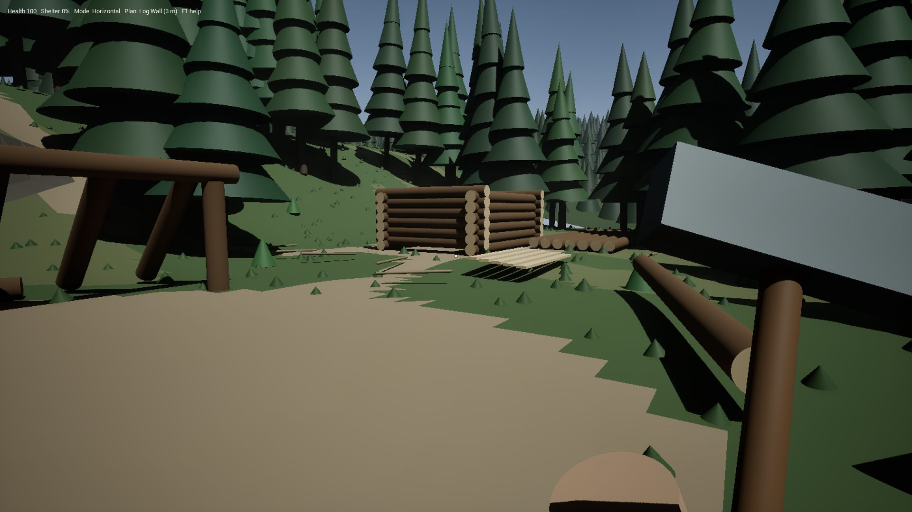
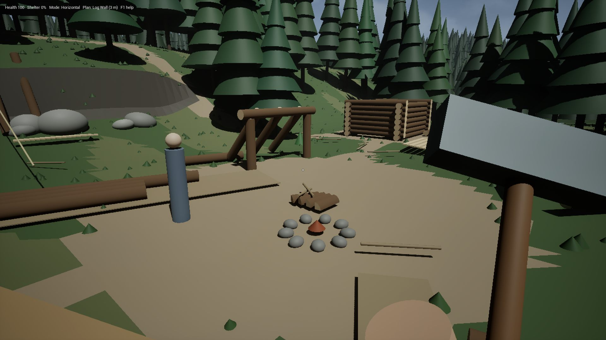
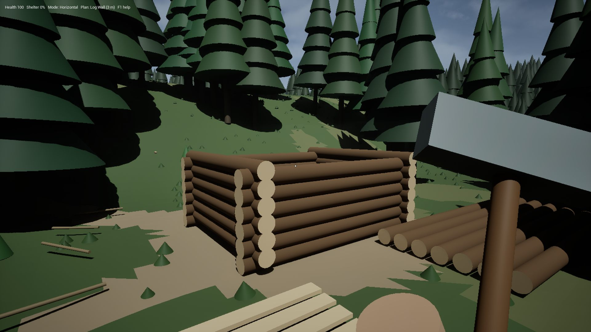
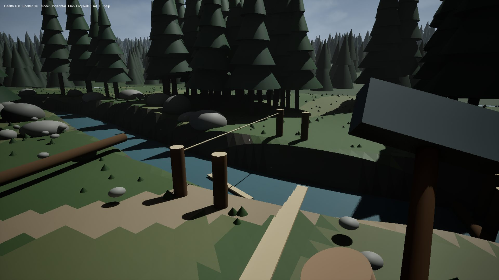
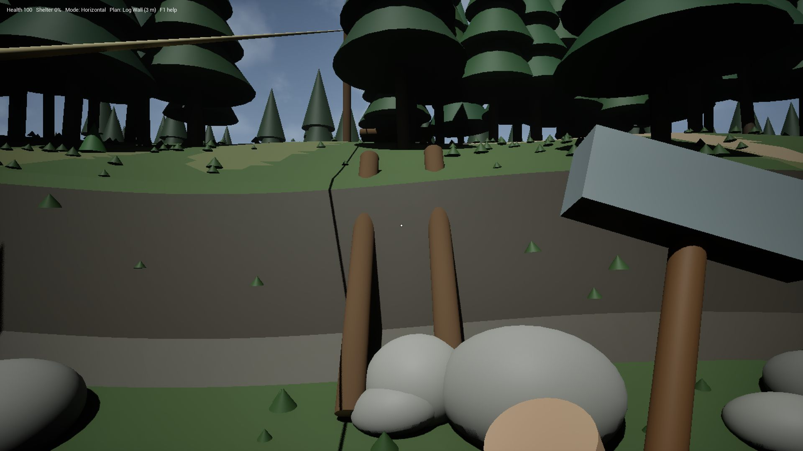
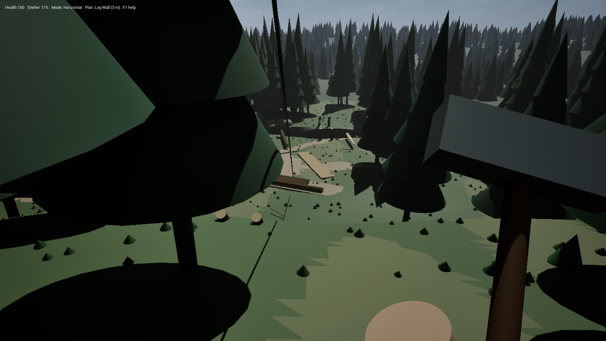
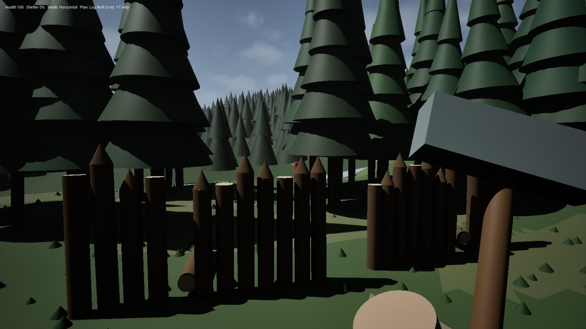
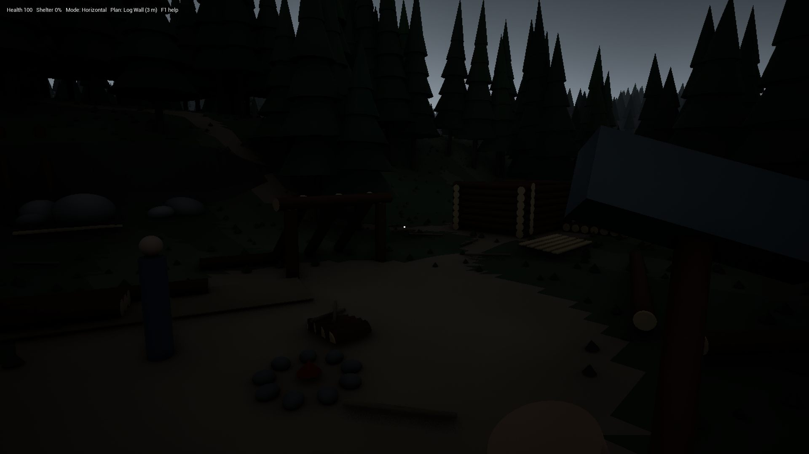

# VerticalSlice_C — Dere Kenarı Açıklığı

Harita: `Content/DemoAssets/Maps/VerticalSlice_C`
Dünyayı kuran sınıf: `AVerticalSliceCWorldActor` ([VerticalSliceCWorldActor.cpp](../../Source/MyProject3/VerticalSliceCWorldActor.cpp))
Haritayı yeniden oluşturma: [CreateVerticalSliceCMap.py](../../UnrealEditorScripts/CreateVerticalSliceCMap.py)



## Bu sahne nedir

Yaklaşık 70 × 70 metrelik, tek parça bir orman açıklığı. İstasyon, tabela ya da test köşesi yok. Mekanikleri yerin kendisi istiyor:

- terk edilmiş bir kamp ve orada bekleyen bir yardımcı,
- kapısı ve çatısı olmayan bir kulübe,
- akıntılı, yürüyerek geçilemeyen bir dere, dereye kurulmaya başlanmış bir kütük yakalama seti ve yıkık bir köprü,
- merdiveni çürümüş bir kayalık,
- tepede bir gözcü direği ve zipline,
- doğuda yıkık bir kazık duvar.

Oyuncu sönmüş ateşin yanında doğar ve yarım kalmış kulübeye bakar. Ekranda tek bir not çıkar: kamp terk edilmiş, kulübenin kapısı ve çatısı yok, köprü yıkık, geceler soğuk ve ateşin yanında bir yardımcı bekliyor. Gerisini oyuncu kendisi keşfeder.

Sahne, Sons of the Forest'ın kütük sistemini bir oynanış döngüsü olarak kuruyor. Döngüdeki adımlar şunlar: ağacı kes, gövdeyi kütüklere ayır, kütüğü taşı ya da kızakla çek, baktığın yerden kes, yerleştir, destekle, depola. Sayfanın sonunda SOTF listesindeki her maddenin bu projedeki durumu var.


Yukarıdan bakış. Önde dere ve kıyı kayaları, ortada kamp ve sundurma var. Sağda kulübe, solda kazık duvar, arkada yamaçtaki kayalık basamak ve gözcü direği görünüyor. Açıklığın çevresi sık, uzun bir ormanla çevrili. Haritanın dışında tepeler ve uzak bir orman uzanıyor, dünyanın kenarı görünmüyor.

## Kütükte işaretler: kırmızı kesim, beyaz yerleştirme

SOTF'ta her işlemin kendi görsel rehberi var. Sahnede de aynısı geçerli:

| İşaret | Ne söyler |
|---|---|
| Kütüğün üstünde kırmızı kesik çizgi | Kütük burada kesilecek. Boyuna yarmada kesik çizgi kütük boyunca uzanır, boy kesiminde kütüğün çevresinde bir halka olur. |
| Gri kesik çizgi | Seçili kesim bu parçada yapılamaz. Yazı nedenini söyler. |
| Taşınan kütüğün çevresinde beyaz kesik çizgi | Kütük bırakılınca tam burada duracak. |
| Beyaz ok | Kütük başka bir parçaya bağlanıyor. Ok, birleşme noktasını gösterir. |


**Bakılan yerden boy kesimi.** C ile "boy kesimi"ni seç ve kütüğe bak. Kırmızı halka, baktığın yere göre yer değiştirir:

- Tam kütüğün ortasına bakarsan halka ortadadır. Kesim iki yarım kütük verir (300 + 300).
- Bir ucundan dörtte bir içeriye bakarsan kesim 3/4 + 1/4 verir (450 + 150) ve kısa parça baktığın uçtan çıkar.
- Yarım kütük ortasından iki çeyreğe, çeyrek kütük iki sekizliğe bölünür.
- Bu noktaların dışında bir yere bakarsan kesim tam orada yapılır, 25 cm'lik adımlarla. Yazı iki parçanın boyunu gösterir, örneğin "400 + 200 cm". Her parça en az 30 cm olur.
- **Dikilmiş direği kısaltmak:** boy kesimi seçiliyken yere dikilmiş bir direğe bak. Halka baktığın yüksekliğe gelir. Kesince direğin alt kısmı yerinde kalır, üst kısmı yanına düşer. SOTF'taki gibi bu yalnızca üstünde hiçbir şey durmayan direkte yapılabilir. Bir şey taşıyan direkte kesim reddedilir.
- **Sivriltme:** dikilmiş bir kütüğün tepesine baltayla bakınca kırmızı kesik bir koni çıkar. Sol tık işaretler, sonraki vuruşlar sivriltir.
- **Kesimi baltayla yapmak:** kütüğe sol tıklayınca kesim yeri işaretlenir, sonraki sol tıklar baltayla keser. F de aynı işi yapar.

**İki aşamalı kesim.** İlk F kesim yerini işaretler ve kırmızı çizgi kalınlaşıp sabitlenir. Sonraki F basışları baltayı sallar ve kesimi ilerletir. C'ye basmak ya da başka bir kütüğe bakıp F'ye basmak işareti iptal eder.

**Gerçek 3/4 boy.** 450 cm'lik kütük modelleri bu sürümle eklendi. Modeller 600'lük modellerden 0,75 boyda üretildi: [CreateLog450Meshes.py](../../UnrealEditorScripts/CreateLog450Meshes.py). Böylece 3/4 kesimi artık gerçekten yapılabiliyor.

## Bölgeler ve neler yapılabilir

### Kamp ve yardımcı



| Ne var | Ne yapılır | Mekanik |
|---|---|---|
| Taş halkalı, sönmek üzere bir ateş | Küçük odunu (en fazla 1/4 boy) taşıyıp E ile ateşe at. Yanma süresi ağırlıkla artar. | Yakıt, ısı kaynağı |
| Ateşin yanında yarılmış küçük parçalar | Al, at, depola | Yakacak odun |
| Çatı direklerinden biri düşmüş bir sundurma | Düşen direği yerine koy. Gereksiz bir desteği Delete ile sök. | Yapı grafiği, çoklu destek, söküm |
| İçinde 3 kütük olan küçük kütük deposu | Boş elle E bir kütük çıkarır. Yakına bırakılan kütükler kendiliğinden içine girer. | Depo, otomatik toplama |
| Yakacak odun deposu | Yalnızca 1/4 boy ve daha küçük parçaları kabul eder. | Depo filtresi |
| Kızak | T ile çek, üstüne kütük yükle. Q ile kızağın üstüne fırlatılan ya da üstüne bırakılan kütük kendiliğinden yüklenir. Yük arttıkça yavaşlarsın. Kızak suda batmaz, derede bırakılırsa akıntıyla sürüklenir. | Kızak, fırlatarak yükleme, taşıma yükü, yüzme |
| Yerde kesilmiş kütükler | Al, taşı, kes, fırlat, yerleştir. Bir kütük taşırken başka bir kütüğe E'ye basarsan ikincisi omzuna biner. İlkini koyunca ikincisi eline geçer. | Taşıma, iki kütük, kesim, fırlatma |


**Yardımcı.** Ateşin yanındaki mavi figür, SOTF'taki Kelvin'in kütük emirlerini yerine getiriyor. J her basışta sıradaki emre geçer:

1. **Beni izle:** oyuncunun birkaç metre arkasından gelir.
2. **Kütükleri depoya topla:** depoya girebilecek en yakın serbest kütüğü bulur, omzuna alır ve onu kabul eden en yakın depoya bırakır. Kimsenin çekmediği bir kızak da depo sayılır. Hiçbir depo kabul etmiyorsa kütüğü oyuncuya getirir.
3. **Kütükleri buraya getir:** emri verdiğin yeri hatırlar ve serbest kütükleri oraya, dörderli sıralar halinde üst üste yığar.
4. **En yakın planı bitir:** Z/Y ile konmuş bir planın sıradaki boş parçası için yeterince uzun bir kütük bulur. Kütüğü parçanın boyuna keser, artanı yere düşer, ve yerine koyar. Planı parça parça tamamlar. Çizilmiş bir savunma duvarı da bir plan olduğu için onu da bitirir.
5. **Duvarları sivrilt ve onar:** bir sıranın parçası olan dik kütüklerin uçlarını sivriltir. Hasar görmüş parçaları onarır, her vuruş 25 hasar puanı siler.
6. **Burada bekle.**

Toplama ve getirme emirlerinde serbest kütük kalmamışsa ağaç keser. Kestiği ağaç binaların ve oyuncunun yakınında olmaz. Ağaç yere oturduktan sonra çıkan kütükleri taşır.

Yaptığı iş ekranın üstünde "Helper: ..." satırında yazar. Taşıdığı kütük, kayıt defterinde yoldaki eşya olarak görünür.

### Kulübe



Altı sıra çentikli kütük duvar var, ama kapı, pencere ve çatı yok. Altı sıra, bir kütük duvarın çıkabileceği en yüksek seviye. Yanında yarılmış kalaslar ve uzun kütükler yığılı.

- **Kapı:** ön duvara bakıp K'ye bas. Duvar kütükleri açıklığın iki yanından kesilir, ortadaki parça önüne düşer, en üst sıra lento olarak kalır. SOTF'taki gibi açıklığa 3 yarılmış kalas taşıyıp E ile tek tek koy. Menteşe tarafı ilk kalasın konduğu yandır ve kapı dışa açılır. E kapıyı açar ve kapatır, L yalnızca içeriden kilitler.
- **Pencere:** P. Açıklık bir dikmeyi keseceğinde işlem reddedilir.
- **Çatı:** sağ tıkla Döşeme moduna geç ve uzun bir kütüğe nişan al. Kütük iki üst duvar kütüğünün arasına oturur, fazla boyu kesilip ayağına düşer. Yan yana dizilen kütükler çatıyı oluşturur ve sol üstteki "Shelter" değeri yükselir.
- **Duvarı uzatmak:** Yatay modda bir duvar kütüğüne nişan al. Kütük 75 cm'lik ızgaraya oturur. Kütüğe paralel tutarsan bir sonraki sıra olarak boylamasına biner, R ile çevirirsen köşedeki gibi çaprazlama oturur. Dikey modda kütüğün üstüne direk dikilir. Beyaz kesik çizgi kütüğün duracağı yeri, beyaz ok da bindiği kütüğü gösterir. SOTF'taki gibi bir duvar en fazla 6 sıra olur, yedinci sıra kabul edilmez.
- **Tek taraflı tepe dolgusu (one-sided apex):** eğik bir kirişin altındaki üçgen boşluğu doldurur. Bir kütük taşırken eğik kirişe bak ve U'ya bas. Kütük kirişin alt ucundan başlayan sıradaki boş yere yatay olarak oturur ve eğime değeceği boya kendiliğinden kesilir. Sıralar yukarı çıktıkça kısalır.

### Dere, kütük yakalama seti ve eski köprü



Dere yaklaşık 2,4 m derin ve kıyıları tırmanılamayacak kadar dik. Düşen biri ancak en doğudaki sığ geçitten, basamak taşlarının olduğu yerden çıkabilir.

- **Akıntı:** dere batıdan doğuya akar. Suya düşen ya da atılan serbest kütükler yarıya kadar batmış halde yüzer ve akıntıyla sürüklenir. Akıntı sığ geçide doğru yavaşlar ve kütükler orada karaya oturur.
- **Yukarıdan gelen kütükler:** dere ara ara yukarıdan kütük getirir (yaklaşık 35 saniyede bir, aynı anda en fazla 3 tane).
- **Halat köprü:** iki kıyıda eski köprünün direkleri duruyor ve aralarında tek bir halat sağlam kalmış. H ile ikinci halatı karşı kıyıdaki direklere bağla. Döşeme modunda kalasları iki halatın arasına dizersen köprü olur.
- **Kütük köprü:** kıyıda 6 m'lik bir kütük yatıyor. Onu dereye dik olarak iki kıyıya oturtmak en hızlı geçiş.


**Kütük yakalama seti.** Köprünün aşağısında, birinin başlayıp bitiremediği bir set var. Suda üç direk duruyor ve birine bir kütük takılmış. Aradaki boşluğa Dikey modda bir kütük dikersen set tamamlanır ve akıntının getirdiği kütükler sete takılır. Yakalanan kütükleri kıyıya alabilir ya da yardımcıya depoya taşıtabilirsin. SOTF'taki dere setinin karşılığı bu.

### Yamaç: kayalık basamak



Yamacın ortasında 2,5 m'lik dik bir kayalık var. Basamakları çürümüş eski bir merdivenin iki kirişi kayalığa dayalı duruyor, dibinde de kısa kalaslar var.

- **Merdiven:** sağ tıkla Merdiven moduna geç ve kirişlere nişan al. Her kalas kirişlerin arasına 40 cm arayla bir basamak olarak oturur. Döşeme modunda kalaslar bitişik dizilir ve rampa olur.
- Merdiven yapmak istemeyen, yamacın batısından dolanan uzun yolu kullanabilir.
- Patikadaki yaşlı, büyük ağaç bir platform için uygun. Ağaca dayanan kütükler gövdeyi destek olarak kullanır. Ağaç kesilirse platform düşer.

### Gözcü noktası ve zipline



Tepede uzun bir direk var. Direkten kampın deposunun yanına uzanan eski bir zipline ve yanında kesilmiş kütükler duruyor.

- Bir kütük taşıyıp direğin dibinde zipline'a bak ve E'ye bas. Kütük halat boyunca kayar ve aşağıda yere iner. Depoya yakın düştüğü için kendiliğinden depoya girer.
- Tepede Z ile bir plan seç ve Y ile yere koy. Planın hayalet kütüklerine kütük taşıyarak yapıyı kurarsın ya da yardımcıya bitirtirsin.

### Hazır planlar

Z planlar arasında dolaşır, Y seçili planı yere koyar. Plan, hayalet kütüklerden oluşan bir taslaktır. Her hayalete kütük taşınır ve kütük o parçanın boyuna kesilir.

| Plan | Ne olur |
|---|---|
| Kütük duvar, sundurma, gözcü kulesi | Temel yapılar |
| Küçük kütük kabin | 4,2 × 3 m, 5 sıra duvar, önde kapı boşluğu, iki üçgen direk, mahya ve 8 çatı direği. Toplam 35 parça. |
| Av barınağı | Mahya ve iki yana yaslanan direkler |
| Küçük platform | Ağaçtan bağımsız, 4 direk üstünde |
| Ağaç platformu, ağaç barınağı | Y'yi bir ağacın yakınında bas, plan gövdeye ortalanır. Alt kirişler gövdeye dayanır ve ağaç kesilirse düşer. Barınağın üstünde direkler ve çatı var. |
| Küçük ve büyük kütük deposu, kızak | Bitince gerçek bir depo ya da kızak olur |
| Kazık savunma duvarı | Çizilerek kurulur: hattın başında Y, sonunda yine Y. Her 40 cm'ye bir kazık konur. Yardımcı da bitirebilir. |
| Bank, sandalye, kanepe, raf, silah rafı | Eşyalar |
| Tavşan kulübesi | Bitince içine bir tavşan yerleşir |
| Köşe rampası | Bir rampa, bir sahanlık ve 90° dönen ikinci bir rampa |

### Doğu: yıkık kazık duvar



Ormana bakan eski bir kazık duvar. Bazı kazıklar sivri, bazıları devrilmiş, kapının olduğu yerde bir boşluk kalmış. Duvarın ötesindeki ormanda biri dolaşıyor ve oyuncuya yaklaşıyor.

- **Sivriltme:** dik duran bir kütüğe X. Uç, parçanın kendi kesitine göre şekillenir: yuvarlak kütükte yuvarlak, çeyrekte kama, kalasta yassı olur. Sivri uca tırmanmaya çalışan yaralanır ve geri itilir.
- **Onarım:** devrilen kazıkları Dikey modda yerine dik.
- **Geçit:** bir kazığa K. Kazıklar sökülür ve geçit açılır. Geçide kalaslarla kapı yapılır.
- **Fırlatma:** Q ile kütük, taş ya da çubuk fırlat. Hızlı bir çarpma tavşanı avlar, çalıyı ezer, düşmanı sendeletir ve yaralar.

### Ağaçlar

Açıklığı çevreleyen orman 7,5 ile 15 m arası ağaçlardan oluşuyor. Kesilen ağaç devrilir, yerde durulur ve gövdesi kütüklere ayrılır. Kaç kütük çıkacağı ve boyları gövdenin gerçek boyuna bağlı. Önce sığdığı kadar 600 cm kütük çıkar, kalan boydan da bir tane 450, 300 ya da 150 cm parça. Örneğin 8 m'lik bir ağaç bir kütük verir, 13 m'lik bir ağaç 600 + 450 verir. Kütükler gövdenin yattığı yere uç uca dizilir. Eskiden her ağaç, boyundan bağımsız olarak 2 ya da 3 tane 600'lük kütük veriyordu.

### Gece



Güneş gün boyunca hareket eder ve oyun 13:30'da başlar. Gece hava kararır, kar yağar ve soğuk artar. Sol üstteki "Shelter" değeri, oyuncunun üstündeki çatıya ve etrafındaki duvarlara göre hesaplanır ve hayatta kalma sistemine gider. Bu yüzden kulübenin çatısı gerçek bir ihtiyaç.

## Tüm mekanikler

| Grup | Mekanik | Nasıl |
|---|---|---|
| Kütükle etkileşim | Alma, taşıma, bırakma | E / G |
| | Aynı anda iki kütük: ikincisi omuzda durur, ilki konunca ele geçer | Kütük taşırken başka kütüğe E |
| | Fırlatma ve çarpma hasarı (hayvan, düşman, bitki, yapı, oyuncu) | Q |
| | İtme, yuvarlama, sürükleme | V / B basılı tut |
| | Yatay, dikey ve 45° yerleştirme. Yokuşta yatay kütük eğime uyar. | Sağ tık ile mod |
| | 75 cm ızgarayla dizme: boylamasına, çaprazlama, direk | Yatay/Dikey modda kütüğe nişan |
| | Uç snap'i: kütük ucu kütüğe girer, uç kısmı diğerinin içine gömülür | Çapraz mod ve dikme uçları |
| | Bir ucu bağlı kütüğün boştaki ucu menteşe gibi aşağı iner. Altına parça konunca kalkar. | Otomatik |
| | Beyaz kesik çizgi yerleşeceği yeri, beyaz ok bağlantıyı gösterir | Kütük taşırken |
| Kesim | Yarma (yarım, çeyrek), yontma (1 ve 2 yüz), kalas, kiriş, oluk, tekne | C seç, F işaretle, F kes |
| | Boy kesimi bakılan yere göre: 1/2 + 1/2 ya da 3/4 + 1/4 (kısa parça bakılan uçtan), yarımda 1/4, çeyrekte 1/8. Bunların dışında istenen noktadan, 25 cm adımla. | C seç, kütük boyunca bak |
| | Dikili direği kısaltma (yalnızca üstünde bir şey yoksa) | Boy kesimi seçiliyken direğe sol tık / F |
| | Tepeyi sivriltme, kırmızı koni işaretiyle | Dikili kütüğün tepesine sol tık |
| | Kiriş ucu zaten bir yere oturuyorsa ya da direk kirişin ortasının altına dikildiyse direk kirişe değecek boya kesilir ve destek olur | Dikey modda direk dik |
| | Payanda: çapraz modda üstünde kiriş olan direğe bak. Direkte 90 cm aşağıdan kirişte 90 cm içeriye konur, tam kütük önce yarılır. Kiriş 4 m'den uzun desteksiz kalacaksa orta direk sökülemez, payandalar bunu mümkün kılar. | Çapraz mod, E |
| | Zeminde beyaz dikdörtgen (yatay) ve daire (dikey). Başka bir direğe 150/300/450/600 cm'ye yakın gelen direk tam o aralığa oturur, aralarında bağlantı çizgisi çıkar. | Kütük taşırken |
| | Yarılmış parçalar dikey direk olamaz. Döşeme, rampa, merdiven ve kapıya götürülen tam kütük kendiliğinden yarılır. | Otomatik |
| | Tek basamak: ikinci destek yokken döşeme kenarına bakınca kalas önüne basamak olarak konur | Döşeme modunda E |
| | Kapıyı çubukla kilitleme | Çubuk taşırken kapalı kapıya içeriden E; L çubuğu çıkarır |
| | Ağır hasarlı parçaya yeni parça eklenemez; baltayla onarılır | Sol tık |
| | Kiriş ucunun altına daha uzun bir direk dikince uç direğin üstüne kalkar | Dikey modda direk dik |
| | Kırmızı kesik çizgi = kesilecek yer, gri = yapılamaz | Nişan al |
| | Kesim yerini işaretle, onayla ya da vazgeç. Kesim balta sallanarak yapılır. | F / F / C |
| | Yerleştirirken fazla boyun otomatik kesilmesi | Döşeme modu, planlar, yardımcı |
| Taş ve çubuk | Alma, üst üste koyma, kütüğe ya da taşa bağlama, yere dikme | E |
| | Çubuk açısı: dik, 45°, yatay | Sağ tık ile mod |
| Yapı | Duvar (en fazla 6 sıra), çerçeve, köşe | Dizme ve snap |
| | Tek taraflı tepe dolgusu: eğik kirişin altı sıra sıra dolar | Kütük taşırken eğik kirişe U |
| | Zemin, tavan, çatı, köprü güvertesi | Döşeme modu |
| | Merdiven ve rampa | Merdiven / Döşeme modu |
| | Payanda: bir parçanın ucu diğerinin altına değince onu taşır | Otomatik |
| | Geçici desteği sökme (yük diğer desteğe geçer) | Delete |
| | Kapı (3 kalas), pencere, geçit. Menteşe, açılma yönü, içeriden kilit. | K / P / L |
| | Sivri kazık ve savunma duvarı | X |
| | Ağaca dayalı platform (ağaç kesilince düşer) | Ağaca dayayarak yerleştir |
| | 19 hazır plan (yukarıdaki tablo). Ağaç planları gövdeye oturur. | Z seç, Y koy |
| | Savunma duvarını çizerek kurma | Kazık duvar planında Y başta, Y sonda |
| Lojistik | Küçük (8), büyük (24) ve yakacak odun (32) deposu, otomatik toplama | E |
| | Kızak: temel 8 kütük, gelişmiş 16 parça. Üstüne fırlatılan kütüğü yükler. Suda yüzer. | T, Q |
| | Halat köprü ve zipline | H iki kez |
| | Dere akıntısı, yüzen kütükler, kütük yakalama seti | Dereye at, sete direk dik |
| | Yardımcı: izle, depoya topla, buraya getir, planı bitir, duvarları sivrilt ve onar, bekle. Kütük kalmayınca ağaç keser. | J |
| Hayatta kalma | Ateşe yakıt, barınak değeri, gün-gece, gece soğuğu | Otomatik |
| Dünya | Ağaç kesme. Gövde boyuna göre 600/450/300/150 cm kütük verir. | Sol tık |

F1 tüm tuşları oyunun içinde gösterir.

## SOTF listesiyle karşılaştırma

Kaynak, ekipte paylaşılan iki SOTF belgesi: "Kütükle yapılabilen her şey" ve "Kütük fiziği ve kesik çizgi sistemi". Madde numaraları o listedendir.

| SOTF ailesi | Var | Kısmen ya da farklı |
|---|---|---|
| Hasat ve fiziksel etkileşim (1–10) | Ağaç kesme, gövde boyuna göre kütük, taşıma, aynı anda iki kütük, bırakma, fırlatma ve hasar, fizik, yerleştirme ve bağlama | — |
| Boy kesimi ve şekillendirme (11–30) | Tam, 3/4, 1/2, 1/4 boy. İstenen noktadan kesim (25 cm adım), kesik çizgi önizlemesi, onay ve iptal. Dikili direği kısaltma. Yarma, kalas, yakacak odun. Otomatik kısaltma, sivriltme. | İstenen noktadan kesilen parçalar ölçeklenmiş mesh. Bu parçalar daha sonra yalnızca yine serbest kesimle kısaltılabilir. |
| Yerleştirme, snap ve hizalama (31–45) | Yatay, dikey, 45°, 90°, döndürme, işaretler, eğimde temel, farklı boylarla kot ayarı, serbest ucu destekleme, kiriş, altına uzun direk koyarak kiriş ucunu kaldırma, kirişin altına direği boyuna göre kesip destek yapma, payanda, payandalarla orta direği sökme (açıklık kuralı) | — |
| Yapı türleri (46–79) | Temel, 6 sıra sınırlı duvar, köşe, direk, döşeme, çatı, barınak değeri, rampa, merdiven, kapı (3 kalas), pencere, kilit, kazık duvar, sivri uç, geçit, çizilerek kurulan savunma duvarı | — |
| Payanda ve destek (80–87) | Yarım kütükten payanda, orta direk sökme, yükseltilmiş platform, tek taraflı tepe dolgusu | Köşe rampası serbest yapı parçası değil, hazır plan olarak var (87) |
| Hazır yapılar (tablo) | Av barınağı, küçük kabin, sundurma, gözcü kulesi, ağaç platformu, ağaç barınağı, küçük platform, bank, sandalye, kanepe, raf, silah rafı, tavşan kulübesi, depolar, kızak | Duvar rafı ve duvar silah rafı yok. Sandalye ve kanepe yalnızca kütükten yapılıyor (deri ve çubuk istenmiyor). |
| Lojistik (88–100) | Küçük ve büyük depo, otomatik yerleşme, temel ve gelişmiş kızak, elle ve fırlatarak yükleme, kızağı çekme, suda kızak, zipline, zipline ile depoya, dere seti, yakacak odun deposu | — |
| Kelvin (101–109) | Kütük toplama, bir noktaya getirme, oyuncuyu izleme, depo ve çekilmeyen kızakları doldurma, plan ve savunma duvarı tamamlama, ağaç kesme, sivriltme ve onarım | — |
| Diğer (110–116) | Halat köprü, yükseltilmiş platform, ağaca bağlı platform, sökme, destek kaybı | — |

## Bilinen sınırlar

- **Görseller:** ağaçlar, kayalar, çimenler, kapı tahtaları, sivri uçlar, canlılar ve yardımcı Unreal'ın temel şekillerinden yapıldı. Gerçek modeller için bir varlık paketi gerekiyor, örneğin Fab'den bir orman paketi. Kütükler gerçek modeller.
- **Kısaltılmış kütükler:** 450'lik modeller, istenen noktadan kesilen ve otomatik kısaltılan parçalar boyca ölçeklendi. Bu yüzden kabuk dokusu biraz sıkışmış ya da esnemiş görünür.
- **Omuzdaki kütük:** oyuncuya sabitlenmiş halde durur, çarpışması yok. Kameranın sağ kenarında görünebilir.
- **Yardımcı:** engellerden kaçmadan düz yürür ve dereyi yatağından geçer. Animasyonu yok, kütüğü omzunda taşır. Oyun kaydına girmiyor.
- **Su:** kaldırma ve akıntı basit bir kuvvetle hesaplanıyor, Unreal'ın su sistemi kullanılmıyor. Kütükler yalnızca dere yatağında yüzer.
- **Kayıt:** sivri uç, kapı, halat, planlar ve yardımcı oyun kaydına girmiyor.
- **Malzeme bedeli:** halat ve balta istenmiyor.
- **Elle deneme:** mekaniklerin mantığı 48 otomatik testle doğrulandı. Bunlara şunlar dahil: bakışa göre ve istenen noktadan kesim, 3/4 boy, yük taşıyan direğin kesilememesi, tepede sivriltme, payanda ve orta direk sökme, direk aralığına oturtma, kendiliğinden yarma, tek basamak, hasarlı parça kuralı, uzun direkle kirişin kalkması, iki kütük taşıma, 6 sıra sınırı, tepe dolgusu, kızağa fırlatarak yükleme, yeni planlar, çizilen savunma duvarı, ağaç platformunun gövdeye bağlanması, gövde boyuna göre kütük, yardımcının bütün emirleri, dere akıntısı ve set. Ama oynanış elle tam bir tur oynanarak denenmedi.

## Görüntüleri yeniden almak

Oyun komut satırıyla açılır, kamera bir noktaya konur ve tek kare çekilir:

```
UnrealEditor.exe MyProject3.uproject /Game/DemoAssets/Maps/VerticalSlice_C -game -NoStartView
    -ExecCmds="EnableCheats, ghost, BugItGo X Y Z Pitch Yaw 0, HighResShot 1920x1080"
```

`-NoStartView` açılıştaki kamera yönünü kapatır, `-StartHour=21.5` oyunu gece başlatır. Bu sayfadaki görüntüler bu yolla alındı.
