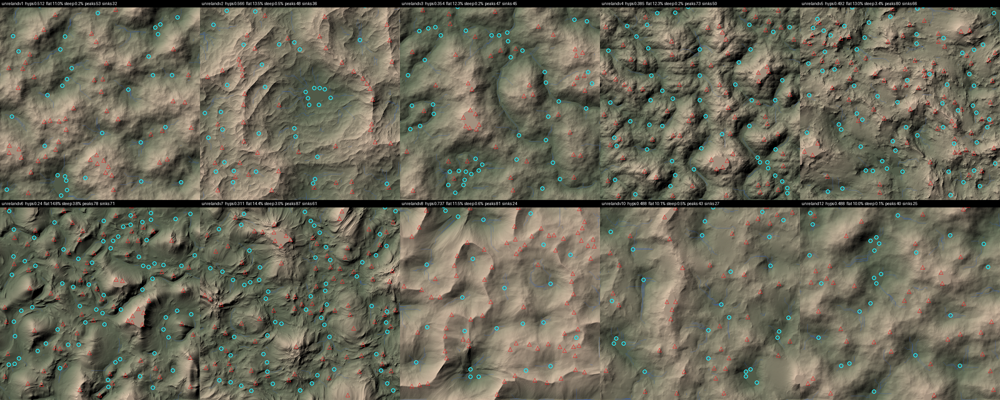

# Heightmap kimlik kartları (adım 1)

Araç: `python tools/heightmaps/heightmap_cards.py` → `SourceArt/World/cards/` (her harita için işaretli önizleme,
`cards.json`). Önizlemede: kırmızı üçgen = tepe, açık mavi halka = kapalı çukur (göl/havza adayı), mavi çizgi = su yolu.

Dosyalarda gerçek yükseklik yok; her harita kendi içinde 0–1'e ölçekli. Bu yüzden sayılar **biçimi** anlatır, metreyi değil.
- **Yükseklik dağılımı**: arazinin ortalama yüksekliği (0–1). Yüksek = yayla/plato, düşük = ova/havza.
- **Düz / dik**: haritanın kendi ortalamasına göre çok düz / çok dik yerlerin payı.
- **Tepe / çukur**: belirgin tepe ve kapalı çukur sayısı.
- **Kenarlar**: K/D/G/B kenarlarının ortalama yüksekliği; komşuyla birleşirken önemli.
- **Gerçek ölçek**: arazi türüne göre önerilen tepe-vadi genişliği → haritanın kapsadığı gerçek alan.

| Harita | Karakter | Yük. dağılımı | Düz % | Dik % | Tepe / çukur | Kenarlar K/D/G/B | Önerilen ölçek (kapsadığı alan) | İyi komşular |
|---|---|---|---|---|---|---|---|---|
| **v1** | Yumuşak yuvarlak tepeler, dağınık çukurlar | 0.51 orta | 11.0 | 0.2 | 53 / 32 | .45/.55/.48/.54 | tepe 500 m → 6.3 km | her şeyle; geçiş dolgusu, orman |
| **v2** | Kademeli plato: basamak basamak yarlar, ortada büyük çanak | 0.57 orta-yüksek | 13.5 | 0.5 | 48 / 36 | .60/.57/.50/.58 | 600 m → 5.3 km | plato (v8), havza (v3) |
| **v3** | Çanaklı ova: geniş yuvarlak havzalar, aralarında su yolları | 0.35 düşük | 12.3 | 0.2 | 47 / 45 | .30/.39/.40/.27 | 520 m → 5.4 km | göl/bataklık (v6), vadi tabanı (v10) |
| **v4** | Sarp dağlık: keskin sırtlar, dar ağaç dallı vadiler | 0.39 orta-düşük (derin vadiler) | 12.3 | 0.2 | 73 / 50 | .25/.26/.25/.33 | 900 m → 14 km | plato (v8), volkanik (v7), etek tepeleri (v1, v12) |
| **v5** | Engebeli yayla: kayalık yarlar, çok sayıda küçük tepe ve çukur (şu anki dünya) | 0.49 orta | 13.0 | **3.4** | 80 / 66 | .42/.44/.45/.56 | şu an 1 m/px → 4 km | tepeler (v1, v12), plato (v2) |
| **v6** | Alçak, kabarcıklı ova: sığ tümsekler, en çok çukur | **0.24 en düşük** | **14.8** | 3.8 | 78 / **71** | .19/.27/.33/.15 | 260 m → 4.2 km | havza (v3), vadi tabanı (v10); göl ve bataklık bölgesi |
| **v7** | Volkanik koniler: zirvelerden ışın gibi açılan sırtlar | 0.31 düşük | 14.4 | 3.0 | **87** / 61 | .36/.31/.48/.36 | 750 m → 8.9 km | dağ (v4), plato (v8) |
| **v8** | Yüksek plato: geniş üst düzlük, kenarından yarıntılarla iner | **0.74 en yüksek** | 11.5 | 0.6 | 81 / 24 | .52/.76/.62/.68 | 800 m → 8.8 km | dağ (v4), kademeli plato (v2) |
| **v10** | Yumuşak vadi tabanı: hafif eğim, belirgin dere yolları | 0.49 orta | 10.1 | 0.5 | 43 / 27 | .51/.48/.51/.46 | 450 m → 4.4 km | her şeyle; üs ve tarım alanı |
| **v12** | Geniş yumuşak tepeler (v1'den daha büyük ve düzgün) | 0.49 orta | 10.0 | 0.1 | 40 / 25 | .49/.49/.51/.52 | 420 m → 4.8 km | vadi (v10), dağ etekleri; orman |

Not: v8 ile zip'teki v9 aynı harita.

## Gruplar

- **Alçak / su**: v6 (en alçak, en çok çukur), v3 (çanaklar) → göl, bataklık, havza.
- **Orta / yaşanabilir**: v10 (vadi tabanı), v12 ve v1 (yumuşak tepeler), v5 (engebeli yayla) → üs, tarım, orman.
- **Yüksek / sarp**: v4 (dağ), v7 (volkanik), v8 (plato), v2 (kademeli plato) → dağlar, kayalık, kenar.

## Hiçbir haritada olmayanlar (adım 3'te üretilecek adaylar)

- Bölgeleri birbirine bağlayan **ana nehir vadisi** (sürekli, aşağı akan, geniş taban).
- **Büyük göl** (v3/v6'daki çukurlar küçük).
- **Kanyon** ve belirgin **dağ geçidi**.
- Geniş **taşkın ovası**.
