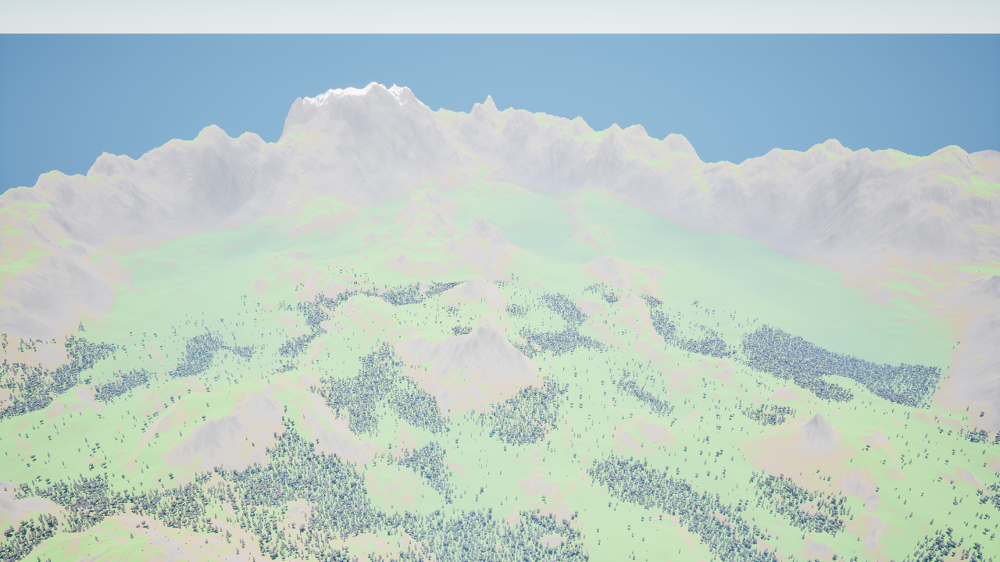
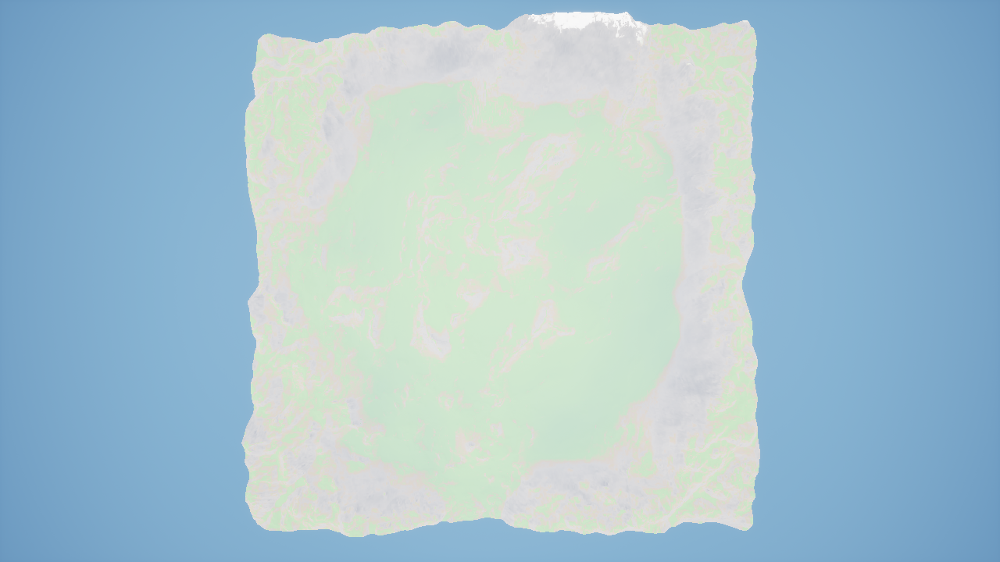
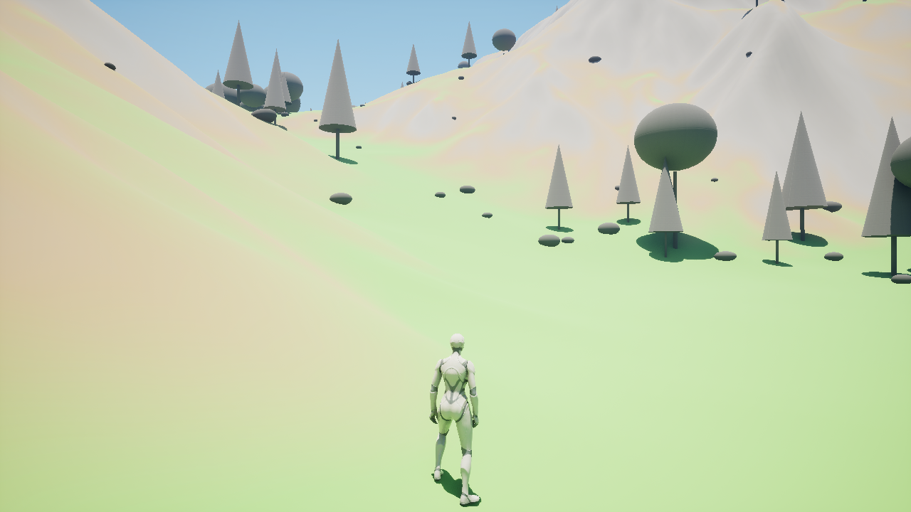
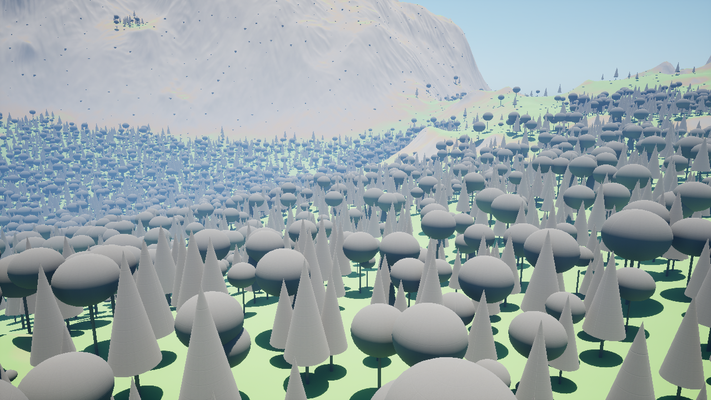
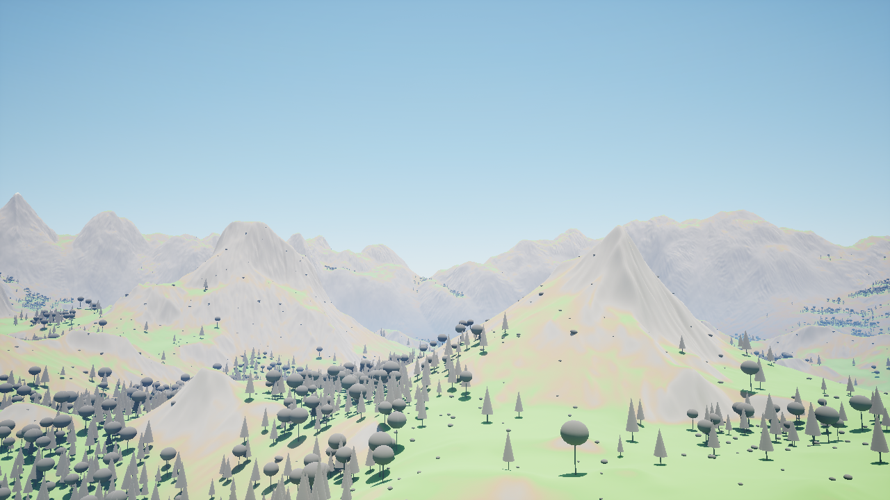
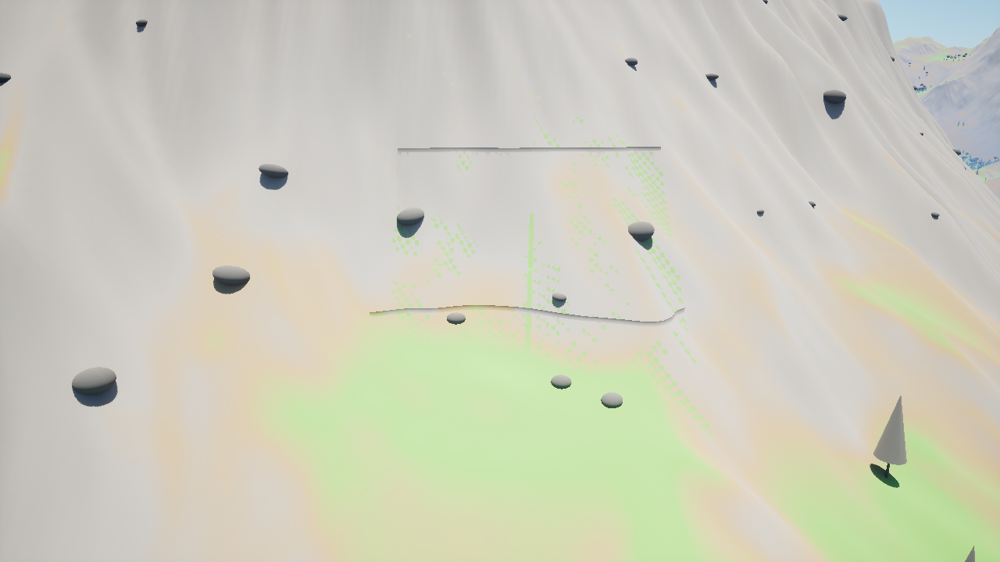

# The World map (`/Game/World/World`)

State on 2026-11-01. 4 x 4 km landscape, built entirely from code and data. Open the map in the
editor and press Play: you are the Third Person template character in the middle of the valley.

## Screenshots

Taken by the game itself: `UnrealEditor.exe MyProject3.uproject /Game/World/World -game -windowed -ResX=1280 -ResY=720 -WorldShots=<folder>`.

| | |
|---|---|
|  Overview from the south-west |  From above (whole map) |
|  Player start |  Forest |
|  Edge mountains to the north |  Cave 1 entrance (known issue, see below) |

## What is in it

| Part | Made by | Notes |
|---|---|---|
| Terrain | `unrelandv5` heightmap, whole, 1 m/px, peaks to 300 m, edge mountains to ~800 m | `tools/heightmaps/build_world_heightmap.py` |
| Plan maps | slope, height, ridge/valley, wetness, soil depth, trees, bushes, rocks, 4 caves | `tools/heightmaps/build_world_masks.py`, previews in `SourceArt/World/masks/` |
| Terrain colour | grass / soil / rock by slope, snow on high flat ground (no textures) | `M_WorldTerrain` |
| Forest | 66k stand-in trees, 27k bushes, 17k rocks (engine basic shapes, instanced) | not choppable yet |
| Character | UE Third Person template (Quinn) | `Content/ThirdPerson`, `Content/Characters`, `Content/Input` |
| Digging (N) | soil to a 15-35 m rock floor; rock not diggable with the test tool | `AWorldGroundActor`, frozen for now (see `memory/WORLD_PLAN.md`) |
| Caves | 4 voxel tunnels, 75-102 m | carved at play start |

## Rebuild from scratch

```
python tools/heightmaps/build_world_heightmap.py   # SourceArt/World/valley.r16 (reads SourceArt/Heightmaps/png/*.png)
python tools/heightmaps/build_world_masks.py       # plan maps, soil depth, caves
UnrealEditor-Cmd MyProject3.uproject -run=BuildValleyWorld -Map=/Game/World/World
```

All numbers live in `Config/GameData/world_layout.json`. The editor must be closed (the map is locked while open).

## Files in Git LFS

`Content/World/World.umap` (140 MB) and the 10 source heightmaps as lossless 16-bit PNG
(`SourceArt/Heightmaps/png/`, 189 MB). Clone with Git LFS installed (`git lfs pull`).
Every new version of the map adds about 140 MB to the LFS storage (GitHub free: 1 GB).

## Known issues (seen in the screenshots)

- **Cave entrances**: the opened 16 x 16 m square shows edge seams and a dotted pattern, and the
  tunnel mouth is not visible; the landscape is not cut cleanly there. Voxel work is frozen, so this
  is listed for step 6 of `memory/WORLD_PLAN.md`.
- Inside the caves it is black (no light source).
- Colours look washed out (auto exposure, no textures).
- Start-up takes ~35 s (cave carving reads landscape heights slowly); cost table in `memory/WORLD_PLAN.md`.
